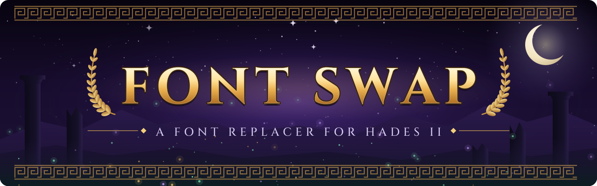

<p align="center"></p>

# Hades II Font Swap

[](https://github.com/usererror/hades2-font-swap/actions/workflows/ci.yml)
[](https://github.com/usererror/hades2-font-swap/releases/latest)
[](LICENSE)

Replace the fonts in **Hades II** with any TrueType (`.ttf`) or OpenType (`.otf`) font
you own.

<!-- Add an in-game before/after screenshot here:  -->

Hades II ships its fonts as pre-rendered bitmap atlases (`.xnb` files), so you can't
just drop a `.ttf` into the game folder. This tool re-renders those atlases with your
font while keeping the game's layout intact:

- **Same size and baseline.** Capitals are matched to the original's height, and line
  spacing and baselines are kept, so text sits where the UI expects it.
- **Nothing goes missing.** Characters your font lacks (Greek, Cyrillic, and so on)
  keep their original glyphs.
- **Small caps are kept.** Small-caps fonts are detected, and lowercase letters are
  drawn as smaller capitals of your font.
- **Safe.** Originals are backed up before anything changes, and one command puts
  them back. After a game update, the backup refreshes itself automatically.

> [!NOTE]
> This tool works with **Hades II only**. Its file format is a Supergiant-specific
> variant of XNA's font format (see [docs/FORMAT.md](docs/FORMAT.md)). Hades, Pyre and
> Transistor use different variants.

## Quick start (Windows)

1. Download `hades2-font-swap-windows-x64.exe` from the
   [latest release](https://github.com/usererror/hades2-font-swap/releases/latest).
2. Close Hades II.
3. Double-click the `.exe`. It finds your Steam install automatically.
4. Type `A`, then drag your `.ttf` or `.otf` file onto the window and press Enter.
5. Launch the game.

To undo, run it again and type `R`.

> [!TIP]
> Windows SmartScreen may warn about an unrecognised app because the executable isn't
> code-signed. Click **More info → Run anyway**. Every release lists SHA-256 checksums
> in `SHA256SUMS.txt` if you want to verify your download.

## Getting a font

This project doesn't include any fonts — supply your own `.ttf` or `.otf`:

- **Free fonts.** Anything from [Google Fonts](https://fonts.google.com) works,
  for example *Cinzel*, *Marcellus* or *EB Garamond*.
- **Fonts you already own.** Those installed on your PC live in `C:\Windows\Fonts`.

## Command-line usage

```text
hades2-font-swap apply   --font PATH [--game-dir DIR] [--lang en] [--include-mono] [--dry-run]
hades2-font-swap restore             [--game-dir DIR] [--lang en]
hades2-font-swap info    FILE.xnb [FILE.xnb ...]
```

| Option            | What it does                                                                  |
| ----------------- | ----------------------------------------------------------------------------- |
| `--font`          | The `.ttf` or `.otf` file to use.                                             |
| `--game-dir`      | Hades II install folder. Auto-detected from Steam if omitted.                 |
| `--lang`          | Language folder to modify. Defaults to `en`.                                  |
| `--fonts-dir`     | Point straight at a font folder (for non-Steam installs).                     |
| `--include-mono`  | Also replace the fixed-width fonts used for timers and counters.              |
| `--dry-run`       | Rebuild everything in memory and report, without writing any files.          |

Examples (PowerShell):

```powershell
.\hades2-font-swap-windows-x64.exe apply --font "C:\Fonts\Cinzel-Regular.ttf"
.\hades2-font-swap-windows-x64.exe restore
```

## What gets changed

Fonts live in `Hades II\Content\Fonts\bin\en`.

| Files                                                     | Behaviour                     |
| --------------------------------------------------------- | ----------------------------- |
| Lato, P22 Underground, Spectral, Caesar Dressing, Noto Sans | Replaced                    |
| `Monospace*`                                              | Skipped by default. Most fonts don't have fixed-width digits, so timers would jitter. Use `--include-mono` to replace them anyway. |
| `ja`, `ko`, `zh-CN`, `zh-TW`, `Lang`                      | Never touched                 |

The originals are copied to `Hades II\Content\Fonts\bin\en_original_backup` the first
time you run `apply`.

**After a game update** (or Steam's *Verify integrity of game files*), the game's
original fonts come back. Run `apply` again: the tool notices the new originals,
refreshes its backup from them, and rebuilds.

## Troubleshooting

| Problem                                 | Fix                                                                       |
| --------------------------------------- | ------------------------------------------------------------------------- |
| `couldn't find Hades II`                | Pass `--game-dir "D:\SteamLibrary\steamapps\common\Hades II"`.             |
| `permission denied`                     | Run from an Administrator terminal.                                       |
| Text overflows its box                  | Your font is wider than the original. Try a narrower font.                |
| Some characters look like the old font  | Your font doesn't contain them, so the originals were kept.               |
| Antivirus flags the `.exe`              | A known false positive for PyInstaller-built apps. Install with Python instead (below) or build it yourself. |
| Anything else                           | Run `restore`, then [open an issue](https://github.com/usererror/hades2-font-swap/issues). |

## Install with Python instead

If you have Python 3.10 or newer, you can install the command directly:

```sh
pipx install git+https://github.com/usererror/hades2-font-swap
# or
uv tool install git+https://github.com/usererror/hades2-font-swap
```

This works on Windows, Linux (including Steam Deck) and WSL. Under WSL it reads your
Windows Steam libraries through `/mnt/c`.

## How it works

1. Decode each original `.xnb`: an Alpha8 glyph atlas plus per-character metrics.
2. Size your font so its capital `H` matches the original's height in pixels.
3. Render every character the original contains, aligned to the original baseline.
4. Copy across original glyphs for characters your font lacks.
5. Pack a new atlas and write the file in the same format.

The full byte layout is documented in [docs/FORMAT.md](docs/FORMAT.md).

## Development

Prerequisite: [uv](https://docs.astral.sh/uv/getting-started/installation/). It
installs the right Python version and all dependencies for you.

```sh
git clone https://github.com/usererror/hades2-font-swap
cd hades2-font-swap
uv sync                      # create .venv with the package and dev tools
uv run pre-commit install    # lint and format automatically on every commit

uv run pytest                # tests
uv run ruff check .          # lint
uv run ruff format .         # format
uv run mypy                  # type-check
uv run hades2-font-swap --help
```

The test suite builds synthetic game files from the openly licensed DejaVu fonts in
`tests/fixtures/`. To also check against your real install:

```sh
HADES2_FONTS_DIR="/path/to/Hades II/Content/Fonts/bin/en" uv run pytest
```

Build the standalone executable into `dist/`:

```sh
uv run python scripts/build_exe.py
uv run python scripts/smoke_test.py dist/hades2-font-swap.exe
```

See [CONTRIBUTING.md](CONTRIBUTING.md) for the release process.

## Disclaimer

This is a fan-made tool and isn't affiliated with or endorsed by Supergiant Games.
Hades II is single-player, and the tool only changes local font files, but you use it
at your own risk. You're responsible for having the right to use whatever font you
choose.

## License

[MIT](LICENSE). The test fixture fonts in `tests/fixtures/` are DejaVu fonts under
their own [license](tests/fixtures/LICENSE-DejaVu.txt).
